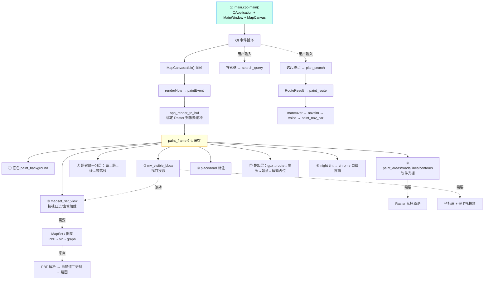

# 第 0 课 · 课程总览与程序运行流程
> 分类：核心代码

> 模块：全局（本目录 18 篇讲义；**先核心代码 00–14，最后跨平台 15–17**；编号 00–17）
> 前置：无。本课是整门课的"地图"，先建立总览，再按**程序运行流程**逐课深入。
>
> **与 `tutorial/` 的关系**：本目录是"读真实源码"式讲义（讲清楚"为什么这么写"）；`tutorial/NN_xxx`
> 是同名编号、可独立编译运行的小程序（看"怎么跑起来"）。两者同号对应，建议对照阅读——
> 其中 `00_overview`（概念总览）与 `tutorial/00_minimal`（最小框架动手热身）是第 0 课的"概念 / 动手"一对；
> `13_datum`（基准数学与交叉验证）与 `tutorial/13_datum`（自包含重实现）是第 13 课的"概念 / 动手"一对；`14_i18n`（极简多语言）与 `tutorial/14_i18n`（自包含重实现）是第 14 课的"概念 / 动手"一对。

> **第 17 课的配套例外**：`17_android` 以真实产品工程 `android/` 为配套（需 NDK/Gradle），没有 `tutorial/17_android` 小程序；00–16 课的「讲义 + 同号小程序」约定不变。

## ① 教学目的

- 建立对本项目的整体认知：它是什么、怎么跑起来、代码是怎么组织的。
- 看懂**程序运行流程图**——一条从"程序入口"到"每一帧像素"再到"用户交互"的主线。
- 明确本课程的实现顺序：**先核心代码（第 0–14 课），最后跨平台代码（第 15–17 课）**；核心段内部按程序运行流程排课，而非按模块依赖表排课。
- 记住五条贯穿全程的教学法原则，后续每一课都会反复用到。

## ② 功能构成

本目录是 [`../teaching-plan.md`](../teaching-plan.md) 的**逐课展开版**：每一课单独成文件，统一按
**① 教学目的 → ② 功能构成 → ③ 怎么实现 → ④ 与其他功能的联系** 四段式详述，并附课堂演示 / 练习 / 验收。
所有代码事实（函数签名、结构体字段、代码片段）均来自当前 `src/` 真实源码。

### 教学法五条总原则（先讲给学生）

1. **能实测就不要估算**——性能瓶颈、算法正确性一律靠 `scripts/regress.sh`、像素判据、确定性量说话。
2. **核心与窗口解耦**——C 渲染核心一行不动，Qt 只把像素缓冲包成 `QImage`。
3. **依赖是纯 DAG**——`utils ← pbf ← map ← route ← render ← ui ← ui_qt`，反向依赖会立刻 `undefined-reference`。
4. **核心零 SDL**——`skedaddle_core` 连 SDL 的 include 都不给；SDL 仅残留在两个去 SDL 化对照体里做"逐像素等价"验证。
5. **文档与代码同频**——讲义里"完整体、逐字"的代码块由 `scripts/regen_tutorial_blocks.py` 从当前源码生成；判据里写死的坐标、开关、基线数字都是"每次改版重测"的活资产，负向对照一旦失效就要重新设计判据。

## ③ 怎么实现：程序运行流程图

本项目的唯一 GUI 进程入口是 `qt_main.cpp` 的 `main()`。它启动 Qt 事件循环，每帧由
`MapCanvas::tick()` 驱动一次 `renderNow() → paintEvent() → app_render_to_buf() → paint_frame()`。
`paint_frame` 内部按固定 9 步把"图集 + 视口"变成"像素缓冲"，并消费搜索 / 路由 / 导航的结果。
下列流程图即本课程的排课依据（从上到下 = 运行时先后）。



ASCII 版（同一张图，便于无 mermaid 渲染时阅读）：

```
qt_main main()                       ┐ 程序入口（第 16 课）
  └─ QApplication + MainWindow + MapCanvas
       └─ Qt 事件循环
            └─ MapCanvas::tick() 每帧
                 └─ renderNow() → paintEvent()
                      └─ app_render_to_buf()         ┐ 唯一渲染入口
                           └─ paint_frame() 9 步      ┘ （第 7 课）
                                ② mv_visible_bbox   → 视口投影（第 5 课）
                                ③ mapset_set_view   → 需要 图集（第 3 课）
                                   └─ 数据来自：PBF→二进制→建图（第 2/3/4 课）
                                ⑤ paint_areas/...    → 需要 Raster（第 6 课）
                                   └─ 依赖：坐标系 + 墨卡托（第 1 课）
                                ⑦ 叠加层：route/gpx/车头
                                ⑧ chrome 自绘界面（含搜索框）
            └─ 用户输入：搜索（第 8 课）/ 选起终点路由（第 9 课）
                            └─ RouteResult → maneuver → navsim → voice（第 10 课）
   全程底座：坐标系（第 1 课）、平台抽象层（第 15 课：线程 / mmap）
   全程守护：架构纪律与验收门禁（第 11 课）
```

### 为什么按这个顺序实现（先核心，最后跨平台）

依赖表 `utils←pbf←map←route←render←ui←ui_qt` 告诉我们"谁不许依赖谁"；而**运行流程**告诉我们
"程序真正跑起来时，先做什么、后做什么"。本课程的**实现顺序**分两段：

**第一段 · 核心代码（第 0–14 课）**：段内严格按运行流程从底座走到收尾，全部是平台无关的 C 核心与其工程化配套。

1. **底座**（第 1 课）：坐标系。读任何运行时代码都绕不开。
2. **数据生产流**（第 2–4 课）：PBF 解析 → 自描述二进制 / 图集 → 建图。这正是 `mapset_set_view`
   在视野变化时加载的内容，也是路由的输入。
3. **每帧渲染流**（第 5–7 课）：视口投影（决定可见范围）→ 软件光栅（画像素）→ 渲染管线编排
   （把前两者与数据编织成一帧）。这条线直接对应 `paint_frame` 的内部步骤顺序。
4. **用户交互流**（第 8–10 课）：搜索、路由、导航与语音——按 UI 上触发的先后出现。
5. **守护与收尾**（第 11–14 课）：架构门禁（第 11 课）守护前面所有课，综合项目（第 12 课）把主干串起来，
   坐标系基准（第 13 课）与极简多语言（第 14 课）是两节进阶专题。

**第二段 · 跨平台代码（第 15–17 课）**：核心跑通之后，**最后**统一处理"换平台 / 换外壳"。

6. **平台抽象层**（第 15 课）：`plat.{c,h}` 是项目里平台差异的唯一收拢点，Windows / Linux / Android 分支都在这里。
7. **桌面外壳**（第 16 课）：Qt 前端（程序入口 `main` / 事件循环）只是包住像素缓冲的外壳，
   它每帧调用的 `paint_frame`（第 7 课）所依赖的数据 / 投影 / 光栅都已在核心段讲完。
8. **移动端外壳**（第 17 课）：Android 原生 JNI App 复用同一个 C 核心，依赖图一个箭头都没改。

> 注：按"实现顺序"而非"调用顺序"排课，是因为严格按 `main()` 的第一个被调用函数来说，Qt 入口
> 应排最前；但那样会导致"还没讲投影 / 光栅 / 数据，就看不懂 paint_frame 在干什么"。
> **运行流程图（§③）仍是"程序怎么跑"的唯一真相；课程表是"人怎么把它实现出来"**——
> 两者不同，且刻意把跨平台代码留到最后：核心一旦跑通，换壳不该再动核心一行。

## ④ 与其他功能的联系

- 本课是**索引**：后续每一课的"④ 与其他功能的联系"都标了上游（它依赖谁）与下游（谁用它），
  对照本课流程图阅读即可串起"坐标 → 数据 → 渲染 → 路由 → 前端 → 门禁"的完整链路。
- 环境搭建、构建命令、CLI 工具清单见 [`../teaching-plan.md`](../teaching-plan.md) 的「一、环境搭建」。

## 课程表（按运行流程排序）

| 文件 | 课次 | 分类 | 主题 | 核心模块 | 配套 `tutorial/` |
|---|---|---|---|---|---|
| [00_overview.md](00_overview.md) | 0 | 核心代码 | 课程总览与程序运行流程（含运行流程图） | 全局 | `00_minimal` |
| [01_coords.md](01_coords.md) | 1 | 核心代码 | 坐标系与大地基准 | `utils/geo`, `utils/datum` | `01_coords` |
| [02_pbf.md](02_pbf.md) | 2 | 核心代码 | PBF 流式解析 | `pbf/*` | `02_pbf` |
| [03_binary.md](03_binary.md) | 3 | 核心代码 | 自描述二进制与图集 | `map/{binfmt,mapset,namepool}` | `03_binary` |
| [04_graph.md](04_graph.md) | 4 | 核心代码 | 建图：PBF→路网 | `map/{graph_build,road_tags}` | `04_graph` |
| [05_viewport.md](05_viewport.md) | 5 | 核心代码 | 视口、投影与瓦片键 | `map/{map_view,tileidx}` | `05_viewport` |
| [06_raster.md](06_raster.md) | 6 | 核心代码 | 软件光栅与性能旋钮 | `render/{raster,paint,navdraw}` | `06_raster` |
| [07_pipeline.md](07_pipeline.md) | 7 | 核心代码 | 渲染管线编排（含标注层：缓存 / 分级 / 字形） | `ui/{window,chrome,offscreen_shot,audit}`, `render/{labels,font}` | `07_pipeline` |
| [08_search.md](08_search.md) | 8 | 核心代码 | 地名搜索 | `search/*` | `08_search` |
| [09_routing.md](09_routing.md) | 9 | 核心代码 | 跨省路由算法 | `route/*` | `09_routing` |
| [10_navvoice.md](10_navvoice.md) | 10 | 核心代码 | 导航层与语音 | `route/{maneuver,navsim,voice}`, `ui/voice_wire` | `10_navvoice` |
| [11_gates.md](11_gates.md) | 11 | 核心代码 | 架构纪律与验收门禁 | `scripts/*`, `tools/*` | `11_gates` |
| [12_capstone.md](12_capstone.md) | 12 | 核心代码 | 综合项目（改一个点 + 加一条判据） | 全程 | `12_capstone` |
| [13_datum.md](13_datum.md) | 13 | 核心代码 | 坐标系基准（datum）：为什么只换椭球等于没转换 | `utils/datum` | `13_datum` |
| [14_i18n.md](14_i18n.md) | 14 | 核心代码 | 极简多语言（i18n）：为什么中文是 msgid 是安全的 | `src/i18n`, `lang/*.xml` | `14_i18n` |
| [15_platform.md](15_platform.md) | 15 | 跨平台代码 | 平台抽象层 | `utils/{plat,mem,strpool}` | `15_platform` |
| [16_qt.md](16_qt.md) | 16 | 跨平台代码 | Qt 前端与边界（含无边框窗口） | `ui_qt/*` | `16_qt` |
| [17_android.md](17_android.md) | 17 | 跨平台代码 | Android 原生 JNI App：把同一个 C 核心搬进手机 | `android/`, `utils/plat` 的 `__ANDROID__` 分支 | `android/ 真实工程（无 `tutorial/` 小程序）` |

## 阅读建议

- **实现顺序 = 课程表顺序**：先核心代码（第 0–14 课，段内按运行流程：底座 → 数据 → 渲染 → 交互 → 门禁 / 综合 / 进阶），
  **最后**跨平台（第 15–17 课：平台抽象层 → Qt 桌面前端 → Android App）。
- 每课"④ 与其他功能的联系"一节都标了上游与下游，建议对照本课的流程图一起读。
- 先读本课流程图，建立"主干"；再逐课下钻"枝叶"。
- 第 17 课是「换壳不换核心」的收尾：`ui_qt` 的同级替代前端，依赖图一个箭头都没改（见第 11 课门禁）。
- **本轮补齐的章节导航**：第 7 课 §3.6 标注层（缓存 / 分级 / 字形）、第 16 课 §3.10 无边框窗口、第 11 课 §3.7 新增判据与讲义同步门禁；逐字块生成脚本见 `scripts/regen_tutorial_blocks.py`。
- 分类由 `scripts/check_tutorial_tracks.py` 验收：第 0–14 课必须是「核心代码」，第 15–17 课必须是「跨平台代码」。
